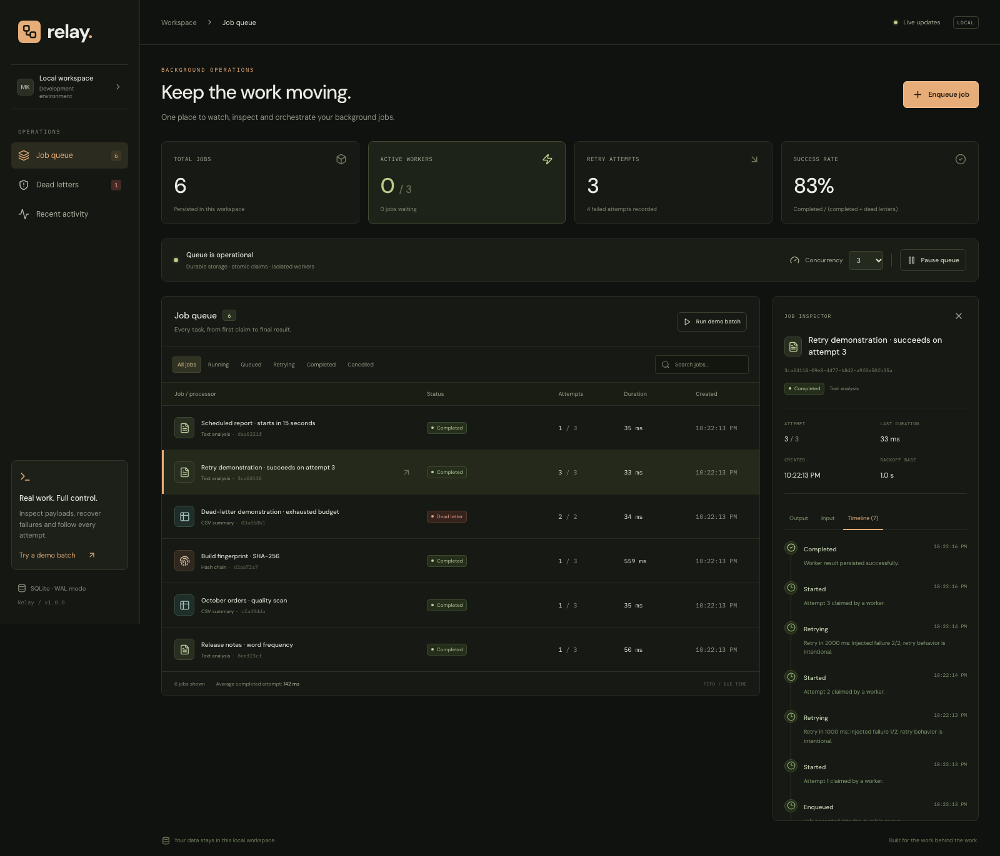
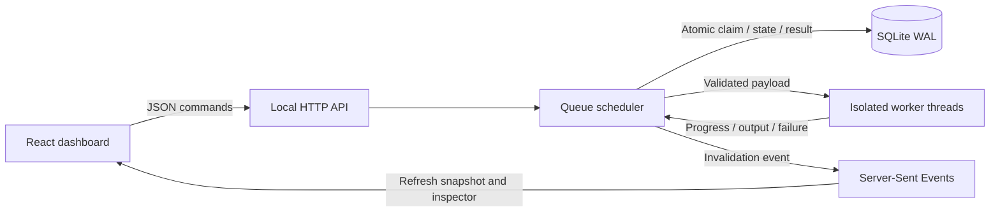
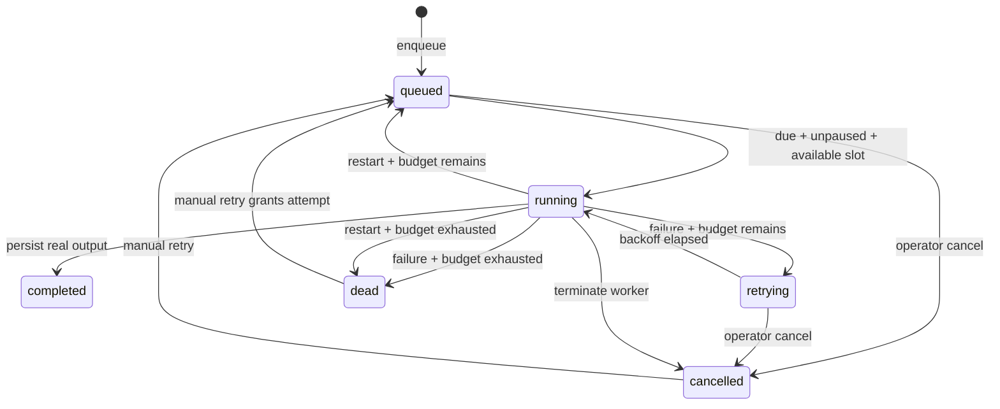

# Relay — Background Job Control Panel

Relay makes background work inspectable. Enqueue real processing tasks, follow each worker attempt, recover exhausted jobs, and keep results across process restarts.

Built with React, TypeScript, Node.js 24, native SQLite and worker threads. Runs locally without API keys, Redis, Docker or a hosted service.



## Getting started

Requires **Node.js 24** and npm. Check your version with `node --version`.

```sh
npm ci
npm run dev
```

Open **http://127.0.0.1:5175**. The API runs on port **4175**. Both bind to localhost. Click **Run demo batch** to enqueue six actual jobs; no history or metrics are preloaded.

For the production build:

```sh
npm run build
npm start
```

Open **http://127.0.0.1:4175**. The Node server serves the built frontend and API together. Jobs, attempts, events and settings persist in `data/relay.sqlite`, which is ignored by Git.

Use a separate database when running another instance:

```sh
RELAY_DB=/tmp/relay-experiment.sqlite PORT=4180 npm start
```

The Vite development proxy always targets 4175; the custom-port example is for the production server.

## What it does

- Real worker-thread processors: Unicode text analysis, quoted CSV summaries, and a deterministic SHA-256 hash chain.
- Durable queue, atomic claims, idempotency keys, scheduled start times and configurable concurrency from 1–8.
- Exponential retries, failure injection, dead-letter handling and manual recovery with complete attempt history.
- Cancel pending jobs or terminate running worker threads. A cancelled job cannot accept a late result.
- Pause new claims while current work finishes. Decreasing concurrency lets existing work drain.
- SSE updates, status filters, search, input/output inspection, a durable event timeline and metrics computed from stored records.
- Crash recovery that records interrupted attempts, preserves completed jobs and requeues unfinished work when retry budget remains.

| Processor | Input | Output |
| --- | --- | --- |
| Text analysis | `text`, up to 500,000 characters | Word and character counts, unique words, top words, sentences, estimated reading time |
| CSV summary | `csv`, up to 500,000 characters | Row count, missing/unique values per column, numeric statistics, duplicates, preview |
| Hash chain | `seed`, `iterations` from 1,000–2,000,000 | SHA-256 digest after the requested number of chained hashes |

CSV parsing handles quoted commas, doubled quotes, CRLF, embedded newlines and a UTF-8 BOM. Malformed rows or duplicate/empty headers fail with an inspectable error. Hash chains demonstrate real cancellable CPU work; they are not a password-storage scheme.

## Try the failure workflow

1. Run the demo batch. The six tasks include two failure demonstrations and a report scheduled 15 seconds later.
2. Inspect **Retry demonstration**. Its first two attempts fail intentionally; the third processes its real text payload. The timeline shows 1-second then 2-second backoff.
3. Open **Dead letters**. The CSV demonstration failed its two allowed attempts. Click **Retry job** to grant one more attempt; the third attempt processes the CSV and saves a result.
4. Pause the queue, enqueue a new job and inspect its input. It stays unclaimed until you resume. You can also cancel it without starting a worker.
5. Enqueue a 2,000,000-iteration hash job. While it is running, click **Cancel job**. The actual worker is terminated and the attempt is recorded as cancelled.
6. For recovery, stop the server while a hash job is running, then restart it with the same database. Its interrupted attempt is visible in the ledger. Completed jobs stay completed.

Failure injection is an explicit testing feature: `failFirst` throws before the processor runs for the first N attempts. Every successful job executes the processor and persists its actual output.

## Architecture



The scheduler owns the SQLite connection. A `BEGIN IMMEDIATE` transaction claims a due job, increments its attempt and writes a started event before a worker is spawned. Results transition only the matching running attempt. Worker identity guards protect concurrent cancellation and manual retry from removing a newer worker.

A process lock and an authoritative transactional owner record prevent two local schedulers from opening the same database. On startup, a dead owner's running jobs are recovered. An interrupted attempt consumes its retry budget; an exhausted job enters the dead-letter queue. Graceful shutdown also terminates workers and records interruptions.



Automatic delay is `backoffMs × 2^(attempt − 1)`. Initial retry budgets are 1–5 attempts; a manual retry grants one additional attempt without resetting history. Idempotency keys deduplicate identical submissions and reject conflicting payloads.

## API

All mutations accept `application/json`. Errors return `{ "error": "..." }` with an appropriate status code. The API is the same in development and production.

| Endpoint | Purpose |
| --- | --- |
| `GET /api/health` | Health check |
| `GET /api/snapshot` | Settings, counters, metrics, recent events and latest 500 jobs |
| `GET /api/jobs/:id` | Input, output, errors, attempt ledger and full job timeline |
| `POST /api/jobs` | Validate and enqueue; returns 201, or 200 for an idempotent duplicate |
| `POST /api/jobs/:id/cancel` | Cancel pending/running work |
| `POST /api/jobs/:id/retry` | Recover dead-letter or cancelled work |
| `POST /api/settings` | Set `paused` and/or `concurrency` |
| `POST /api/demo` | Enqueue six real demonstration tasks |
| `GET /api/events` | SSE invalidations and heartbeat; reconnect refreshes current state |

```sh
curl -X POST http://127.0.0.1:4175/api/jobs \
  -H 'Content-Type: application/json' \
  -d '{"name":"Release note analysis","type":"text-analysis","input":{"text":"Durable queues need observable work."},"maxAttempts":3,"failFirst":1,"backoffMs":1000,"delayMs":0,"idempotencyKey":"release-42"}'
```

## Verification

```sh
npm test
npm run build
npx playwright install chromium
npm run test:browser
npm run benchmark
npm run benchmark -- --workload hash --jobs 12 --concurrency 3 --iterations 100000
```

The automated suite contains **19 passing engine/API tests**, including actual worker results, a 130,000-row CSV, exponential backoff timing, idempotency/conflict, delayed claims, pending/running cancellation, concurrent cancel/retry, concurrency bounds, HTTP commands, SSE reconnects, foreign-origin/hostname rejection and restart after **SIGKILL**. The restart test verifies the interrupted attempt is recovered while a previously completed job keeps its original attempt count.

The Playwright smoke uses the production frontend and a temporary database. It exercises the demo, dead-letter recovery, enqueue, pause/resume, pending/running cancellation, output inspection, desktop/mobile layout and live updates. Screenshots are generated from those real jobs. CI runs the engine/API suite, TypeScript/build and Chromium smoke on Node 24.

One measured local benchmark on **Node v24.21.0 / Apple M4 / macOS arm64** processed **100 text jobs × 13,700 characters** at concurrency 3:

| Measurement | Observed result |
| --- | --- |
| Total time, including enqueue | 1,450.56 ms |
| Enqueue time | 45.55 ms |
| Jobs / second | 68.94 |
| Completed attempt p50 / p95 / max | 38 / 58 / 86 ms |
| Maximum observed workers | 3 |
| Completed jobs with persisted output | 100 |

This is one reproducible local run, including worker startup and durable writes. It is not a production capacity guarantee. The benchmark checks outputs and the concurrency bound, prints the actual environment and deletes its temporary database.

## Decisions and limits

**SQLite instead of Redis:** keeps setup small and puts jobs, attempts, events and state transitions in one transactional store. Its synchronous API and single local scheduler suit a developer tool; this is not a distributed queue.

**Worker per attempt:** isolates CPU work and makes cancellation real. It costs startup overhead; a reusable worker pool is a sensible next step for higher throughput.

**At-least-once recovery:** a process can die after computing a result but before committing it. That job may run again. Current processors are pure computations, so recovery is safe. External side effects would need their own idempotency and transactional strategy.

**Local access:** no authentication or user accounts. The server binds to 127.0.0.1, rejects foreign mutation origins and non-local hostnames, limits requests to 1 MB, and accepts only the three bounded processor types. Do not expose it as a public service without authentication, authorization, quotas and a deployment review. There is no arbitrary shell, SQL or filesystem task execution.

**History:** the dashboard lists the latest 500 jobs; metrics include all persisted jobs. Each inspector shows its full stored history. There is no retention policy or pagination yet. SSE invalidations refresh current state rather than replaying missed UI events.

**Metrics:** success rate is `completed / (completed + dead letters)`; pending and cancelled jobs are excluded. Retry attempts count executed attempts after the first, including manual and recovered attempts. Average duration is the mean of successful attempt durations and includes worker startup. Reading time is an estimate at 200 words per minute.

## License

MIT © Mert Kanıbir. See [LICENSE](LICENSE). Bundled fonts retain their [DM Sans](docs/DM-Sans-LICENSE.txt) and [IBM Plex Mono](docs/IBM-Plex-Mono-LICENSE.txt) open font licenses. See [verification notes](docs/VERIFICATION.md) for the observed local flows.
